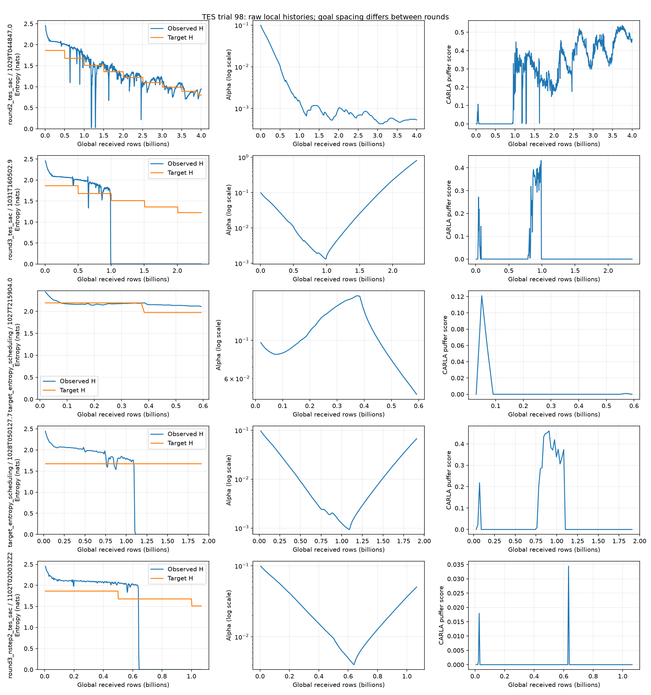

# TES trial 98: entropy and policy collapse

**Finding:** the latest Round 3, its two-step TES derivative, and the long original
TES trial 98 suffer persistent entropy collapse within their observed histories.
Round 2 also suffers a severe transient collapse, but recovers.
The strongest explanation is weak entropy regularization followed by an abrupt
actor/critic instability and policy saturation. The logs establish the failure;
they do not identify the initiating minibatch or prove a unique numerical cause.

The isolated configurations in this directory are prevention experiments, not a
validated cure. From this folder, preview using `bash scripts/launch.sh --round 3 --variant stabilized
--dry-run --no-wandb`; see [README.md](README.md) for the real launch command.

## Evidence and scope

Snapshot extracted on 2026-11-02 at 18:34 UTC directly from local run artifacts,
including 3,208 learner records and 1,604 saved `carla_fast` evaluations across
four standard TES trial-98 runs and the Round 3 two-step TES run. This refreshes the older analysis directory;
that directory was not modified. Frozen-PPO collection variants are excluded.

| Run | Observed received rows | Entropy failure | Driving result |
|---|---:|---|---|
| Original TES, Oct 28 | 1.908B | H=0 from epoch 108; 83 zero-H records | Peak puffer score .4602; final 0 |
| Round 2, Oct 29 | 4.000B | Minimum H=.02774; no exact zero | Recovers; later peaks at .5375, ends .4627 |
| Round 3, Oct 31 | 2.361B | H=0 from epoch 368; 577 zero-H records | Peak .4318; final 0 |
| Round 3 two-step TES, Nov 2 | 1.066B snapshot | H=0 from epoch 238; 168 zero-H records | Peak .03443; latest evaluation 0 |
| Short original attempt, Oct 27 | .593B | H ends 2.109; no entropy collapse | Ends with puffer score 0 despite high H |

The Oct 27 attempt is useful counterevidence: high entropy alone does not ensure
useful driving. Its initial target also differs from the later runs. Do not merge
its records with the Oct 28 restart. The Round 2 run completed; Round 3 and the
long original run were cancelled (exit -9), not successfully completed.

Full IDs, source paths, hashes, numerical milestones, and all extracted points are
in [evidence/provenance.json](evidence/provenance.json),
[evidence/summary.json](evidence/summary.json),
[evidence/training.csv](evidence/training.csv), and
[evidence/evaluations.csv](evidence/evaluations.csv).

## What happened in Round 3

The run is `round3_tes_sac_20261031T160502.985825452_2741255/trial_98`.
H and alpha below are learner-cycle means; the target is the controller's current
value at logging. Each cycle contains 48 logical actor updates, so this is not a
minibatch-level trace.

| Epoch | Received rows | H, nats | Target H | Alpha | Critic loss | Eval puffer score |
|---:|---:|---:|---:|---:|---:|---:|
| 183 | 502.112M | 2.0124 | 1.677312 | .01067 | .00140 | See CSV |
| 364 | 987.264M | 1.6272 | 1.677312 | .001308 | .00421 | .43175 |
| 365 | 989.664M | 1.6396 | 1.677312 | .001315 | .01068 | Not scheduled |
| 366 | 992.160M | .33476 | 1.677312 | .001351 | .12375 | 0 |
| 367 | 994.784M | .001543 | 1.677312 | .001437 | .50354 | Not scheduled |
| 368 | 997.216M | 0 | 1.677312 | .001505 | .59742 | 0 |
| 371 | 1,004.320M | 0 | 1.509581 | .001659 | .18190 | Not scheduled |
| 944 | 2,361.184M | 0 | 1.222760 | .809331 | .05344 | 0 |

At epoch 364, evaluation speed was 2.895 m/s, progress ratio .28949, and off-road
rate .016. At epoch 366, speed was .559 m/s and off-road rate .66088. At the end,
speed was .249 m/s, progress ratio .02494, and off-road rate .8776. This is a
degenerate driving policy, not successful cautious driving with a lower score.

Behavioral failure appears at the same evaluation as the abrupt entropy drop,
before the first logged H<.1 or H=0. Critic loss rises roughly 142x from epoch 364
to 368. Q1 falls from 3.117 to 2.096 over that interval and eventually to -3.153.
These values show a coupled instability; they do not establish whether a critic
error or an actor update happened first within the cycle.

## What happened in Round 2 and original TES

Round 2's `round2_tes_sac_20261029T044847.014369240_539543/trial_98` shows the same
dangerous precursor: alpha falls below .001 while entropy is near its target.
At epochs 445–448, entropy falls 1.5659 → 1.0760 → .1880 → .02774 while target H
stays 1.509581. At epoch 447 critic loss reaches .2263, compared with .00530 at
445. Evaluation score drops to .00258 at 446 and .00788 at 450. But entropy
recovers to .788 at 453 and 1.242 by 500; evaluation recovers too.

Only six Round 2 learner records have H<.1, and none has H=0. At 3.748B rows the
run reaches its best evaluation: score .53753, speed 4.772 m/s, progress .47723.
At 4.000B it ends at score .46271, speed 3.354 m/s, H=.95057 and target=.802253.
The later drop from the selected peak is not another permanent zero-entropy
failure. A peak-to-final comparison alone would misdescribe this run.

The long original run, `target_entropy_scheduling_20261028T050127.741263566_3833135`,
does permanently collapse. H first falls below .1 at epoch 104 / 1.104B rows,
with alpha .001047 and target still 1.677312; evaluation score becomes zero.
H is exactly zero by 108 / 1.142B and never recovers through 1.908B. Its forced
decay is disabled: forced decay cannot be a necessary cause of the failure.
It also used an 8,192,000-row replay per rank and a qualifying count of 1,
compared with 2,048,000 rows and a count of 200 in Round 2/3; this is contextual
evidence of recurrence, not an otherwise identical schedule ablation.

## Additional failure: Round 3 two-step TES

Run: `project/soft_actor_critic_multi_step_return/runs/round3_nstep2_tes_sac/`
`sac108_grid_20261102T020032Z258872951/trial_98`. The snapshot captures 405 learner
records through 1,066,272,000 received rows and 202 evaluations through epoch 404
/ 1,063,744,000 rows. There is no completion summary at inspection time; these
are snapshot endpoints, not final results.

| Epoch | Received rows | H | Target H | Alpha | Critic loss |
|---:|---:|---:|---:|---:|---:|
| 234 | 633.440M | 1.9925 | 1.677312 | .004147 | .009961 |
| 236 | 638.592M | 1.9147 | 1.677312 | .004044 | .030211 |
| 237 | 641.312M | .33766 | 1.677312 | .004068 | .205638 |
| 238 | 643.936M | 0 | 1.677312 | .004260 | .692467 |
| 405 | 1,066.272M | 0 | 1.509581 | .050311 | .053651 |

The best observed evaluation was already weak: epoch 234 had puffer score
.03443, speed .96946 m/s, and progress ratio .09695. At epoch 236, puffer score
already drops to zero while entropy is still 1.9147; speed is .69210 m/s and
some goal-reaching behavior remains. At epoch 238, entropy is zero, goals are
zero, and the severe failure vector appears. By the latest evaluation,
score is zero, speed .56592 m/s, progress .05659, off-road .65488, and collision
.10584. Unlike one-step Round 3, this run did not first reach a strong driving
policy; it has both poor pre-collapse learning and subsequent entropy saturation.

The first forced target reduction was at 502.240M rows (epoch 183), and the second
at 1,002.784M (epoch 380). Neither coincides with the sharp collapse at 643.936M.
Alpha subsequently increases about 12x, but entropy remains exactly zero in all
168 captured records from epoch 238 onward. The logged effective return horizon
is approximately two before collapse and about 1.91 afterward, consistent with
more boundary-shortened returns; a horizon change alone does not establish a
collector defect.

This strengthens the diagnosis of a shared actor/critic/temperature instability:
two-step returns do not prevent it. It also weakens any explanation based only on
one-step targets or alpha crossing one universal threshold: this run collapses
around alpha .004 rather than the one-step run's .0015. The relevant quantities
include action-value gaps relative to alpha, logit saturation, and actor update
size; raw logit and gap diagnostics remain missing. The earlier collapse is an
observation from these particular runs, not proof that two-step returns generally
cause earlier collapse. Changing the horizon changes bootstrapping and introduces
uncorrected intermediate behavior-policy dependence, so an additional horizon
effect remains possible.

Saved learner configs match in environment, TES parameters, gamma, tau, learning
rates, and replay settings; their differences are the return horizon and expected
run identity/catalog paths. Thus the two-step comparison is more closely matched
than the older-round comparison, but still lacks replicated runs.

The existing `round3_constant_control` and `round3_stabilized` candidate configs
are one-step controls. They do not automatically preserve this run's `n_steps=2`;
an equivalent two-step intervention must explicitly retain that horizon and its
private benchmark catalog. No new candidate training was launched for this update.

## Mechanism: what is verified and what is inferred

1. **The alpha update has the correct sign.** In
   [`_train_replay`](../../../pufferlib/pufferl_sac.py), the implemented loss is
   `log_alpha * (H.detach() - target_H)`. Gradient descent lowers alpha when H is
   above target and raises it when below. Round 3 demonstrates both directions.
   There is no evidence here of a reversed sign or a temperature optimizer that
   stopped updating. Entropy arithmetic is FP32 even with BF16 network forwards.

2. **Regularization gets very weak before the collapse.** In
   [`_policy_loss`](../../../pufferlib/pufferl_sac.py), the actor minimizes
   `sum_a p(a|s) * [alpha * log p(a|s) - min(Q1,Q2)]`. At Round 3's peak, alpha is
   .001308 versus the initial .1: approximately 76 times smaller. The entropy
   contribution's scale alpha*H is about .00213. The ideal per-state soft optimum
   has `p(a)/p(b) = exp((Q(a)-Q(b))/alpha)`, so smaller alpha makes a fixed action
   value gap much more decisive. Logged Q1/Q2 are means for replay actions, not
   per-state action gaps; they cannot prove that this sensitivity caused the
   particular update. The actor still has LR about .000458 and makes 48 updates
   per collection cycle, with no policy-KL constraint or logit bound.

3. **A saturated softmax can become practically unrecoverable.** Both the Q term
   and entropy term differentiate through action probabilities. When probabilities
   for alternatives approach zero, their gradients become tiny; finite-precision
   underflow can make them zero. Raising alpha then need not restore exploration.
   Round 3's alpha rises from .001505 to .809331, over 500x, while all subsequent
   cycle averages remain H=0 (577 records including the first zero). This strongly supports policy saturation as the
   persistent state. It does not prove literal underflow rather than extremely
   small gradients, nor that every state chooses the same action. Raw logits,
   action histograms, per-state entropy quantiles, and gradient norms were not
   logged. Round 2's nonzero entropy and recovery are consistent with avoiding
   that fully saturated state.

4. **TES can aggravate the weakness but is not an entropy floor.**
   `AdaptiveTargetEntropyController.observe` uses an EMA and cumulative qualifying
   count. `_decay` only multiplies target by .9; it has no lower bound, upward
   recovery, or performance check. With forced decay enabled, a 500M-row timeout
   bypasses the entropy stability gates. Round 3's first forced reduction was at
   .502B, long before collapse; its second at 1.004B happened after H reached zero.
   Thus the second reduction did not trigger the collapse. Continuing to lower a
   target during collapse weakens recovery pressure, but disabling forced decay
   alone does not address the original TES run's failure. A target of 1.68 is also
   not a guarantee that observed H cannot fall below it: alpha is a learned soft
   constraint, not a projection onto a minimum entropy.

5. **Replay and bootstrapping can sustain the failure.** Round 2/3 trial 98 refreshes half
   the 2,048,000-row per-rank replay each cycle and trains three passes over the
   full buffer: approximately six sampled transitions per new valid insertion
   in steady state. Once collection degenerates, useful driving examples are
   displaced. With gamma=.999, critic targets are strongly bootstrapped; changing
   policy and entropy also changes those targets. This is a plausible feedback
   mechanism, not proof of Q overestimation, replay corruption, or a terminal-mask
   bug. There is no such bug established by this investigation.

The TES paper proposes entropy annealing as a heuristic, not an anti-collapse
guarantee: [Xu et al., Target Entropy Annealing for Discrete SAC](https://arxiv.org/abs/2112.02852).
The actor/critic coupling is also consistent with the broader discrete-SAC
instability studied in [Revisiting Discrete SAC](https://arxiv.org/abs/2209.10081).
Neither paper establishes the cause of this particular run; the local evidence
above is the basis of the diagnosis.

## Fix candidates and why these changes

| Candidate | Target schedule | Actor LR | Alpha LR / annealing | Purpose |
|---|---|---:|---|---|
| Existing R2/R3 | Adaptive + 500M forced decay | .0005 | .0003 / on | Historical comparison |
| `constant_control` | Constant 1.863680; no forced decay | .0005 | .0003 / on | Isolate target-schedule contribution |
| `stabilized` | Constant 1.863680; no forced decay | .0001 | .0003 / on | Add a 5x smaller actor step |

There are separate copies for Round 2 and Round 3, retaining each round's training
and evaluation spacing. Replay, gamma, tau, critic LR, budgets, 97/98 grid mapping,
and evaluation cadence remain inherited. These are SAC control experiments under
the TES project; the constant schedule deliberately suspends TES annealing.

The slower actor is intended to reduce abrupt concentration while critics and
temperature adapt. It does not impose a hard entropy floor and cannot guarantee
recovery or prevent every collapse. A larger alpha LR was deliberately rejected
for this initial comparison: it also drives alpha downward faster when H exceeds
target. Disabling cosine annealing was rejected too: alpha LR was still 91.5% of
its initial value at the Round 3 collapse, and the current annealing switch also
controls actor and critic rates. Those would add unnecessary confounders.

Use a fresh learner, not the saturated actor or its optimizer state. The launcher
creates isolated run directories, and the candidate configs set `fresh_run: true`
with no resume or model load. This does not modify or restart existing jobs.

## Validation and interpretation limits

The current controller suite passes: **34 tests** in
`tests/unit_tests/test_sac_target_entropy.py`. This verifies controller behavior,
not policy quality. Launcher dry-run and configuration parity evidence is recorded
in the README. No GPU training, simulator rollout, or checkpoint-logit inspection
was performed for these candidates.

Round 3 changes training goal spacing from 20–200m to 6.667–66.667m and evaluation
spacing from 30m to 10m. Its absolute scores are not a controlled comparison to
Round 2. All evaluations here contain 250 scenarios; these are single training
seed histories, not replicated intervention trials. Evaluation uses mean actions,
whereas collection samples the actor. Learner entropy is averaged on replay
observations, not measured on benchmark observations. Evaluation timings therefore
localize a failure interval rather than prove sample-level causality.

For a candidate to count as successful, require sustained nonzero entropy and
useful progress beyond the old failure windows (~1.0B Round 3 and ~1.18B Round 2),
then through its full budget. Track score, progress, speed, off-road rate and
action distributions together; merely raising H is insufficient. Compare constant
control with stabilized at equal received rows within the same round. Replicate
promising outcomes before calling the issue fixed.

Next action: run the README's dry-run command and inspect its generated trial-98
configuration before allocating GPUs.
